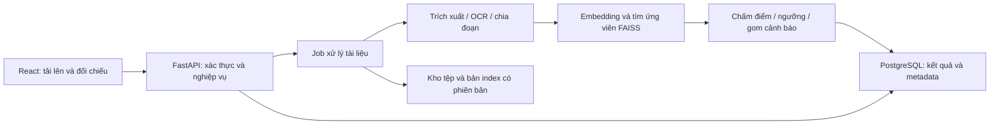

# Kế hoạch xây dựng hệ thống tự động kiểm tra và cảnh báo trùng lặp văn bản trong báo cáo đồ án

Ngày lập: 19/09/2026. Căn cứ: `De_cuong.md`, bốn module Python hiện có, dữ liệu JSON, `IMPLEMENTATION_PLAN_v2.md` và `SLIDE_BAO_CAO_DOT_1.md`.

Đây là kế hoạch thực thi từ trạng thái hiện tại. Sử dụng mã G0–G9 bên dưới để giao việc và bàn giao cho AI; không đồng nhất các mã này với số giai đoạn trong kế hoạch v2. Kế hoạch v2 được giữ làm tài liệu lịch sử. Tình trạng thực thi được cập nhật tại [TIEN_DO_AI.md](TIEN_DO_AI.md).

## 1. Mục tiêu và phạm vi

Hoàn thiện luồng: tải báo cáo PDF/DOCX → trích xuất và OCR khi cần → chia đoạn có vị trí → đối chiếu kho báo cáo trước → sinh cảnh báo → giảng viên xem đoạn nghi vấn cạnh nguồn đối chiếu.

Sản phẩm cuối phải có kho tham chiếu, kiểm tra ngữ nghĩa, nguồn và vị trí đối chiếu, giao diện, lịch sử kết quả, phân quyền cơ bản, bộ dữ liệu đánh giá và hướng dẫn chạy lại. Kết quả là cảnh báo hỗ trợ thẩm định; điểm cosine không phải xác suất hoặc phần trăm đạo văn.

Không đưa vào phạm vi bắt buộc: tìm trên toàn Internet, phát hiện mã nguồn, huấn luyện mô hình từ đầu, hệ thống phân tán. So khớp từ vựng là phần bổ sung hỗ trợ sao chép trực tiếp; chỉ triển khai một baseline trước, không đồng thời làm Winnowing, MinHash và LSH.

## 2. Hiện trạng đã đối chiếu

| Thành phần | Có trong mã nguồn/dữ liệu | Khoảng trống cần xử lý |
|---|---|---|
| `extractor.py` | PDF theo trang; DOCX theo paragraph | DOCX gộp vào trang 1, chưa đọc bảng; PDF scan chỉ cảnh báo |
| `preprocessor.py` | NFC, lọc dòng rác, tách câu/từ, chia chunk | Chưa giữ ánh xạ về văn bản gốc; câu dài có thể vượt 500 ký tự; chưa loại header/footer thực sự |
| `pipeline.py` | Batch, xuất JSON, chuyển tệp đã xử lý | `--watch` quét một lần; chưa có job liên tục và cơ chế phục hồi; ID dựa vào tên tệp |
| `vector_store.py` | SBERT, chuẩn hóa L2, FAISS, lưu/nạp, top-k | Truy vấn chuỗi chưa tiền xử lý thống nhất; loại cùng tên tệp và lấy dư 5 kết quả chưa bảo đảm đủ nguồn hợp lệ |
| Dữ liệu | Hai tệp tài liệu và hai JSON, tổng 17 chunk | Chưa có tập nhãn; chưa xác nhận số vector hoặc chất lượng index bằng chạy lại |
| Web và nghiệp vụ | Chưa thấy API, CSDL, frontend, tests trong cây tệp hiện tại | Cần triển khai và nghiệm thu |

Các nhận xét trên là kiểm tra tĩnh và đếm JSON, không phải chứng nhận chạy thành công mô hình. Không dùng nhận định “17 vector từ 3 tài liệu” trong kế hoạch cũ làm số liệu thực nghiệm. Thư mục hiện tại cũng chưa được lệnh `git status` nhận diện là Git repository.

## 3. Kiến trúc và nguyên tắc xuyên suốt

Giữ Python, thư viện trích xuất, underthesea, mô hình đang tích hợp và FAISS làm nền tảng ban đầu. Kiến trúc đích theo đề cương: FastAPI + PostgreSQL + React; OCR cơ bản bằng Tesseract. Đây là lựa chọn triển khai của kế hoạch, chưa phải các thành phần đã cài hoặc kiểm chứng tương thích. Chốt phiên bản sau khi kiểm tra môi trường ở G0; không mở thêm nhánh Vue/Qdrant/PaddleOCR trong luồng chính.



- Tách hai luồng: **nhập kho tham chiếu** và **kiểm tra báo cáo mới**. Báo cáo mới không tự trở thành nguồn tham chiếu; chỉ người có quyền mới duyệt nhập kho.
- Dùng `document_id`, `document_version`, `chunk_id` ổn định và hash nội dung; tên tệp chỉ để hiển thị. Loại tự khớp theo ID/phiên bản và chính sách bản sao, không theo tên.
- Giữ bản gốc để hiển thị, bản chuẩn hóa để xử lý, và ánh xạ vị trí giữa hai bản. PDF dùng trang + khoảng ký tự; DOCX dùng mục + chỉ số đoạn/bảng, `page = null` nếu chưa có bản render đáng tin cậy.
- Mỗi lần kiểm tra lưu phiên bản model, tiền xử lý, ngưỡng, snapshot kho và cấu hình. Đổi model/chunking phải xây lại index tương ứng.
- FAISS lưu vector; PostgreSQL lưu nghiệp vụ. Dùng ánh xạ vector theo snapshot, không xem số thứ tự vector là ID vĩnh viễn qua mọi lần xây lại.
- Kiểm thử và ghi tài liệu trong từng giai đoạn. Chỉ đánh dấu hoàn tất khi có đầu ra và bằng chứng kiểm tra; dữ liệu thiếu hoặc test chưa chạy phải ghi rõ.

Cấu trúc đích, tạo dần khi cần:

```text
app/
  api/          # Router và schema
  core/         # Cấu hình, xác thực
  services/     # Trích xuất, xử lý, tìm kiếm, báo cáo
  db/           # Models, migration, repository
  workers/      # Job xử lý, retry, phục hồi
frontend/
tests/
evaluation/     # Manifest, nhãn, cấu hình và script đánh giá
docs/           # Đặc tả, quyết định, nghiệm thu từng giai đoạn
KE_HOACH_TRIEN_KHAI.md
TIEN_DO_AI.md
```

Service không phụ thuộc router FastAPI. Khi di chuyển bốn module hiện có, giữ các lệnh CLI cũ hoạt động bằng wrapper nếu cần.

## 4. Lộ trình và các mốc bàn giao

Thời lượng là ước lượng ngày làm việc của nhóm, chưa gán tên cá nhân vì chưa có phân công xác nhận. Tổng khoảng 43–58 ngày làm việc; điều chỉnh theo dữ liệu, phần cứng và hạn nộp thực tế. Không tự động coi các mốc ngày trong v2 là đã hoàn thành.

| Giai đoạn | Thời lượng | Phụ thuộc | Kết quả chính |
|---|---:|---|---|
| G0 | 1–2 ngày | Không | Baseline và đặc tả có thể kiểm chứng |
| G1 | 5–6 ngày | G0 | Lõi xử lý và vị trí nguồn đáng tin cậy |
| G2 | 4–6 ngày | G1 | Bộ dữ liệu và quy trình đánh giá |
| G3 | 4–5 ngày | G1, G2 | Kiểm tra toàn bộ báo cáo qua CLI |
| G4 | 5–6 ngày | G3 | CSDL, kho tham chiếu và job bền vững |
| G5 | 5–6 ngày | G4 | API có xác thực và phân quyền |
| G6 | 5–6 ngày | G5 | Giao diện kiểm tra và đối chiếu |
| G7 | 5–7 ngày | G6 | OCR và baseline từ vựng |
| G8 | 5–7 ngày | G7 | Thực nghiệm cuối và tối ưu có số liệu |
| G9 | 4–7 ngày | G8 | Đóng gói, tài liệu và bộ bảo vệ |

Có thể thu thập tài liệu được phép sử dụng ngay từ G0. Mốc demo lõi: hết G3; mốc demo web: hết G6; mốc nghiệm thu kỹ thuật: hết G8; mốc bàn giao: hết G9. Nếu thiếu thời gian, giảm tính năng phụ, quy mô giao diện và thuật toán mở rộng; vẫn phải có truy vết, phân quyền và đánh giá trung thực.

## 5. Công việc, nghiệm thu và bước tiếp theo

### G0 — Chốt đặc tả và kiểm chứng nền tảng

**Đầu vào:** mã nguồn và dữ liệu hiện tại.

- [ ] G0.1: Kiểm kê môi trường Python, thư viện, model cache, phần cứng, số tài liệu/chunk/index; ghi riêng số đã đo và số chưa xác minh.
- [ ] G0.2: Chạy thử trích xuất, batch và tìm kiếm trên bản sao dữ liệu; ghi lệnh, đầu ra và lỗi. Không ghi đè index gốc hoặc di chuyển dữ liệu mẫu khi kiểm chứng.
- [ ] G0.3: Viết `docs/requirements.md`: vai trò người dùng, kho tham chiếu, loại báo cáo, giới hạn upload, cách xử lý trích dẫn/mục lục/tài liệu tham khảo và định nghĩa cảnh báo.
- [ ] G0.4: Viết `docs/baseline.md`, cập nhật README theo chức năng thực có; ghi quyết định kiến trúc và tiêu chí chất lượng mục tiêu cần đạt ở G8.

**Nghiệm thu:** có log tái hiện baseline hoặc ghi rõ phụ thuộc đang chặn; đặc tả phân biệt được tìm top-k với quyết định cảnh báo. Nếu thiếu môi trường khiến baseline chưa kiểm tra được, G0 chưa được đánh dấu DONE.

**AI làm tiếp:** chuyển G1, bắt đầu hợp đồng metadata và kiểm thử hồi quy lõi.

### G1 — Ổn định trích xuất, metadata và tìm kiếm

**Đầu vào:** đặc tả và baseline G0.

- [ ] G1.1: Định nghĩa schema document/chunk/location, ID ổn định, lưu văn bản gốc và ánh xạ sang bản chuẩn hóa.
- [ ] G1.2: Giữ số trang PDF; DOCX giữ heading, paragraph và bảng theo thứ tự đọc. Không tạo số trang giả. Phần nội dung chưa hỗ trợ phải có cảnh báo.
- [ ] G1.3: Chuẩn hóa dùng chung cho lập kho và truy vấn; xử lý câu dài theo giới hạn tokenizer của model đã kiểm chứng; ghi phiên bản chunking và quy tắc overlap.
- [ ] G1.4: Sửa truy vấn rỗng, `top_k` không hợp lệ, kho rỗng, loại tự khớp bằng ID/hash; lấy thêm ứng viên đến khi đủ k hợp lệ hoặc hết kho.
- [ ] G1.5: Kiểm tra số vector–metadata, chiều vector và phiên bản khi nạp; xử lý tệp hỏng, trùng tên, ghi dở và lỗi từng tài liệu. Sửa mô tả cosine về miền lý thuyết [-1, 1].
- [ ] G1.6: Thêm test có ý nghĩa cho vị trí PDF/DOCX, Unicode, câu dài, hai tài liệu cùng tên, nhiều self-match, lưu/nạp và lỗi dữ liệu. Test offline dùng vector giả; một kiểm tra tích hợp riêng dùng model thật.

**Đầu ra:** lõi được sửa, schema metadata, `tests/`, ghi chú tương thích dữ liệu cũ và cách xây lại index.

**Nghiệm thu:** mỗi kết quả truy được đúng tài liệu và vị trí; không tự khớp; truy vấn và kho dùng cùng pipeline; test phù hợp đạt, có ít nhất một log tích hợp model thật. Không coi test bằng vector giả là chứng minh chất lượng ngữ nghĩa.

**AI làm tiếp:** chuyển G2, tạo manifest và hướng dẫn gán nhãn trên schema đã ổn định.

### G2 — Tạo tập đánh giá và quy tắc hiệu chỉnh

- [ ] G2.1: Thu thập tài liệu được phép dùng; mục tiêu khởi đầu 10–15 báo cáo và khoảng 200–300 cặp đoạn. Đây là quy mô đề xuất, không phải dữ liệu đã có hay bảo đảm thống kê.
- [ ] G2.2: Tạo bốn nhóm: sao chép trực tiếp, diễn đạt lại, cùng chủ đề nhưng khác nội dung, không liên quan; bổ sung biểu mẫu chung và trích dẫn hợp lệ để đo cảnh báo sai.
- [ ] G2.3: Viết hướng dẫn nhãn và cho hai thành viên rà soát một phần dữ liệu; giải quyết bất đồng. Dữ liệu tổng hợp phải có cờ nhận diện và được kiểm tra thủ công.
- [ ] G2.4: Chia development/validation/test theo tài liệu gốc hoặc họ tài liệu; bản sao và paraphrase của một nguồn cùng nhóm. Không chia ngẫu nhiên các chunk của cùng báo cáo vào nhiều tập.
- [ ] G2.5: Cố định query, nguồn tham chiếu và positive match cho từng split. Nguồn đối chiếu có thể nằm trong kho đánh giá, nhưng tài liệu truy vấn không được tự khớp. Không dùng nhãn test để chọn ngưỡng.
- [ ] G2.6: Viết script đo Precision/Recall/F1, ma trận nhầm lẫn và Recall@k truy xuất; định nghĩa đơn vị đo, xử lý mẫu không có positive và trường hợp chia cho 0.

**Đầu ra:** `evaluation/manifest.*`, nhãn, split, hướng dẫn nhãn và script đánh giá; dữ liệu riêng tư không đưa vào Git công khai.

**Nghiệm thu:** kiểm tra không rò rỉ nhóm tài liệu, có đủ nhóm tình huống và biết nguồn từng nhãn; script chạy trên ví dụ kiểm chứng được bằng tay. Nếu chưa có dữ liệu thật, ghi BLOCKED cho phần phụ thuộc dữ liệu, không thay bằng số liệu giả.

**AI làm tiếp:** chuyển G3, dùng validation hiệu chỉnh baseline ngữ nghĩa; giữ test cuối chưa dùng để lựa chọn.

### G3 — Kiểm tra toàn bộ báo cáo và sinh cảnh báo

- [ ] G3.1: Tạo service kiểm tra báo cáo: xử lý tất cả chunk → truy ứng viên từ kho tham chiếu → loại tự khớp → áp ngưỡng → lưu kết quả có nguồn.
- [ ] G3.2: Chọn `top_k` và ngưỡng trên validation theo tiêu chí G0; lưu model/preprocessing/split/metric kèm cấu hình. Ngưỡng thử nghiệm chưa hiệu chỉnh phải được ghi rõ.
- [ ] G3.3: Gom match gần nhau theo cả vị trí truy vấn và nguồn; giữ các match gốc để đối chiếu. Xếp hạng nguồn bằng độ bao phủ và điểm, công bố quy tắc.
- [ ] G3.4: Xuất JSON báo cáo có `check_id`, trạng thái, cảnh báo trích xuất, vị trí hai phía, điểm, ngưỡng, nguồn và phiên bản.
- [ ] G3.5: Nếu hiển thị tỷ lệ, tính: độ dài hợp các khoảng văn bản được đánh dấu / độ dài văn bản đủ điều kiện kiểm tra × 100. Cả hai dùng cùng hệ tọa độ văn bản đã quy định; overlap không tính hai lần. Gọi là “tỷ lệ nội dung được cảnh báo”; mẫu số 0 trả không đủ dữ liệu.

**Đầu ra:** service kiểm tra, CLI kiểm tra tệp và xuất báo cáo, cấu hình ngưỡng, kết quả validation.

**Nghiệm thu:** chạy được từ tệp đến báo cáo JSON; có trường hợp không cảnh báo, trường hợp nhiều nguồn, kho rỗng và không đủ văn bản. Tỷ lệ không vượt 100%; PDF scan chưa OCR không được báo “0% trùng lặp” như đã kiểm tra thành công. Báo cáo các lỗi phát hiện thay vì bắt model phải đúng mọi ví dụ.

**AI làm tiếp:** chuyển G4, lưu tài liệu, job và báo cáo này vào CSDL.

### G4 — Lưu trữ nghiệp vụ và quản lý kho tham chiếu

- [ ] G4.1: Thiết kế PostgreSQL và migration: `users`, `documents`, `document_versions`, `chunks`, `check_jobs`, `checks`, `matches`, `index_snapshots`, `audit_events`.
- [ ] G4.2: Lưu chủ sở hữu, quyền dùng làm tham chiếu, hash, đường dẫn nội bộ, vị trí, phiên bản cấu hình; ràng buộc khóa ngoại và chống tạo job trùng khi retry.
- [ ] G4.3: Xây trạng thái `queued → processing → completed/failed`; lưu bước đang chạy, lỗi, số retry và cơ chế phục hồi job bị gián đoạn.
- [ ] G4.4: Một tiến trình ghi index tại một thời điểm; xây snapshot tạm, kiểm tra mapping rồi công bố snapshot hoàn chỉnh. Khi lỗi giữ snapshot cũ; đối soát và rebuild từ CSDL thay vì giả định FAISS và SQL có transaction chung.
- [ ] G4.5: Nhập/rút tài liệu khỏi kho, vô hiệu hóa nguồn bị rút trong tìm kiếm mới, xác định cách hiển thị nguồn cũ theo quyền; lịch sử giữ snapshot/cấu hình của lần kiểm tra.
- [ ] G4.6: Chuyển metadata về CSDL/định dạng an toàn; chỉ đọc pickle cũ từ dữ liệu nội bộ đã xác minh, không nhận pickle qua upload.

**Nghiệm thu:** khởi động lại còn lịch sử; retry không nhân đôi chunk/match; lỗi giữa ghi DB và công bố index không tạo kết quả lệch nguồn; migration chạy được trên PostgreSQL và có hướng dẫn backup/restore.

**AI làm tiếp:** chuyển G5, expose service qua API và áp quyền trên từng tài nguyên.

### G5 — API, xác thực và phân quyền

- [ ] G5.1: Đặc tả rồi xây đăng nhập, tải tệp, danh sách tài liệu, tạo job kiểm tra, trạng thái job, báo cáo và nhập kho tham chiếu.
- [ ] G5.2: API dự kiến: `POST /api/documents`, `POST /api/documents/{id}/checks`, `GET /api/jobs/{id}`, `GET /api/checks/{id}`, `GET /api/documents`, `GET /api/health`; auth và quản trị có router riêng. Chốt request/response trước khi frontend sử dụng.
- [ ] G5.3: Quyền tối thiểu: sinh viên xem bài/kết quả của mình; giảng viên xem bài được phân công; quản trị quản lý người dùng và kho. Kiểm tra quyền nguồn ở cả endpoint báo cáo, đoạn trích và tải file.
- [ ] G5.4: Hash mật khẩu, quản lý secret ngoài mã nguồn; giới hạn đăng nhập, upload, số trang, thời gian xử lý. Kiểm tra cấu trúc PDF/DOCX, tên lưu nội bộ và đường dẫn; không chỉ kiểm tra đuôi tệp.
- [ ] G5.5: API tạo job trả ID để UI theo dõi; lỗi trả mã dễ hiểu, log không chứa toàn văn nhạy cảm. Có pagination và validation tham số.

**Nghiệm thu:** test API từ upload đến lấy báo cáo; tài khoản A không đọc được tài liệu/job/báo cáo/nguồn của B ngoài phạm vi được cấp; upload sai định dạng/quá giới hạn bị từ chối; OpenAPI khớp thực tế.

**AI làm tiếp:** chuyển G6, xây UI theo hợp đồng API đã nghiệm thu.

### G6 — Giao diện và luồng sử dụng hoàn chỉnh

- [ ] G6.1: React có đăng nhập, tải báo cáo, danh sách/lịch sử, tiến độ xử lý và báo lỗi có hướng xử lý.
- [ ] G6.2: Trang báo cáo hiển thị tỷ lệ được cảnh báo, nhóm đoạn nghi vấn, nguồn xếp hạng, điểm và ngưỡng; lọc theo nguồn/mức cảnh báo nếu đã có quy tắc được hiệu chỉnh.
- [ ] G6.3: Hiển thị hai cột đoạn truy vấn–đoạn nguồn, nhảy đúng trang PDF hoặc mục/đoạn DOCX; chỉ highlight mức chính xác được metadata hỗ trợ.
- [ ] G6.4: Phân biệt trạng thái chưa kiểm tra, không đủ văn bản, không có nguồn phù hợp, xử lý một phần và xử lý lỗi; không dùng cùng một số 0 cho mọi trường hợp.
- [ ] G6.5: Giao diện quản trị nhập/rút nguồn, và xuất báo cáo HTML hoặc JSON có cấu hình/phiên bản. Định dạng PDF là bổ sung nếu còn thời gian.

**Nghiệm thu:** người dùng hoàn tất upload → theo dõi → xem cảnh báo → mở nguồn → xem lại lịch sử qua giao diện; kiểm tra quyền và trạng thái lỗi; có log/ảnh demo từ dữ liệu được phép dùng.

**AI làm tiếp:** chuyển G7, bổ sung OCR và đo lợi ích của so khớp từ vựng trên validation.

### G7 — OCR cơ bản và bổ sung sao chép trực tiếp

- [ ] G7.1: Tesseract xử lý trang thiếu text layer; PDF hỗn hợp giữ text gốc ở trang có chữ, chỉ OCR trang cần thiết. Lưu `extraction_method`, vị trí và lỗi từng trang.
- [ ] G7.2: Đặt giới hạn độ phân giải/số trang/thời gian; kiểm tra tiếng Việt, trang trắng, ảnh nhiễu. Lỗi OCR hoặc trang bị bỏ qua phải thể hiện trong báo cáo.
- [ ] G7.3: Xây một baseline từ vựng bằng n-gram hoặc Winnowing; hợp ứng viên lexical với semantic để không bỏ sót chỉ vì semantic top-k thiếu ứng viên.
- [ ] G7.4: So sánh semantic, lexical và kết hợp trên cùng validation. Chỉ giữ phương án kết hợp khi có lợi ích đo được; semantic-only vẫn là baseline bắt buộc phải báo cáo.
- [ ] G7.5: Không suy ra “đã diễn đạt lại” chỉ từ điểm ngữ nghĩa cao; dùng nhãn cảnh báo mô tả bằng chứng như “tương đồng ngữ nghĩa” hoặc “trùng từ vựng”. Hiệu chỉnh lại ngưỡng nếu thay pipeline.

**Nghiệm thu:** một PDF scan và một PDF hỗn hợp đi xuyên suốt hệ thống, nguồn truy đúng trang; có bảng so sánh validation và phân tích lỗi OCR. OCR cơ bản thuộc đầu ra đề cương, không bỏ qua âm thầm nếu thiếu môi trường cài đặt.

**AI làm tiếp:** chuyển G8, khóa cấu hình ứng viên và đánh giá test cuối.

### G8 — Đánh giá cuối, hiệu năng và nghiệm thu kỹ thuật

- [ ] G8.1: Khóa model, ngưỡng và snapshot; đánh giá test giữ riêng, công bố Precision/Recall/F1, số mẫu từng nhóm, ma trận nhầm lẫn và Recall@k. Nêu rõ cách tổng hợp theo cặp/chunk và mức báo cáo nếu có.
- [ ] G8.2: Phân tích false positive/false negative, trường hợp cùng chủ đề, đoạn mẫu, paraphrase và OCR. Nếu dùng kết quả test để sửa cấu hình, tập đó không còn là test độc lập; cần tập mới hoặc công bố giới hạn.
- [ ] G8.3: Đo trích xuất/OCR/embedding/search/toàn luồng; ghi CPU/GPU/RAM, kích thước tài liệu/kho, số lần chạy, cold/warm và p50/p95 khi đủ mẫu.
- [ ] G8.4: Chạy unit/integration/end-to-end; kiểm tra phục hồi job, phân quyền, hạn mức tài nguyên và backup/restore. Tối ưu chỗ nghẽn đã đo, chạy lại kiểm tra bị ảnh hưởng.
- [ ] G8.5: Đối chiếu mục tiêu chất lượng/hiệu năng G0; ghi đạt/chưa đạt, nguyên nhân và giới hạn. Không tự đặt số đo để đạt mục tiêu.

**Đầu ra:** `docs/evaluation_report.md`, kết quả thô, lệnh tái lập, cấu hình khóa và biên bản nghiệm thu.

**Nghiệm thu:** người khác chạy lại được phép đo với cùng dữ liệu được cấp quyền; không có lỗi nghiêm trọng về quyền hoặc truy vết; mọi mục tiêu chưa đạt được công bố và xử lý theo quyết định của nhóm trước bàn giao.

**AI làm tiếp:** chuyển G9, đóng gói đúng phiên bản vừa nghiệm thu.

### G9 — Đóng gói, tài liệu và bảo vệ

- [ ] G9.1: Docker/Compose cho ứng dụng và PostgreSQL, cấu hình mẫu, migration, seed demo; quản lý model cache và dữ liệu persistent. Không đóng gói secret/tài liệu riêng tư.
- [ ] G9.2: README cài đặt từ môi trường sạch, hướng dẫn sử dụng từng vai trò, backup/restore, xử lý lỗi và tái lập thực nghiệm.
- [ ] G9.3: Báo cáo gồm bài toán, cơ sở lý thuyết, thiết kế, triển khai, thực nghiệm, hạn chế; sơ đồ ERD, API và hình giao diện khớp bản cuối.
- [ ] G9.4: Slide và kịch bản demo: sao chép, diễn đạt lại, không liên quan, OCR và lỗi có kiểm soát; chuẩn bị model cache và log/video dự phòng.
- [ ] G9.5: Ghi mã phiên bản bàn giao, chạy smoke test trên môi trường sạch. Nếu sửa lỗi sau đóng gói, kiểm tra phần liên quan và cập nhật phiên bản/tài liệu.

**Nghiệm thu:** bộ mã nguồn, cấu hình, dữ liệu demo hợp lệ, báo cáo, slide và log kiểm tra cùng phiên bản; hoàn tất đối chiếu tất cả mục tiêu `De_cuong.md`.

**AI làm tiếp:** đặt tiến độ dự án là hoàn tất và liệt kê hạn chế/hướng phát triển; chỉ mở công việc mới khi người dùng giao, không tự kéo dài phạm vi.

## 6. Quy trình để AI tiếp tục đúng sau mỗi giai đoạn

1. Đọc `KE_HOACH_TRIEN_KHAI.md`, `TIEN_DO_AI.md`, chỉ dẫn repo nếu có và mã liên quan. Kiểm chứng trạng thái thực tế trước khi dựa vào checkbox.
2. Chọn `next_task` chưa hoàn thành trong giai đoạn hiện tại; rà đầu vào và phụ thuộc. Không làm lại công việc đã có bằng chứng đạt.
3. Khi bắt đầu, đặt giai đoạn `IN_PROGRESS`. Mỗi nhiệm vụ xong phải có tệp đầu ra và kiểm tra phù hợp; ghi test chưa chạy cùng lý do.
4. Khi đủ tiêu chí, tạo `docs/handoffs/Gx.md` theo mẫu bên dưới; đánh dấu `DONE`, cập nhật `current_stage`, `next_task`, `next_action` và danh sách tệp cần đọc.
5. Nếu người dùng yêu cầu “làm giai đoạn Gx”, hoàn thành và bàn giao Gx rồi dừng. Nếu yêu cầu tiếp tục toàn kế hoạch, có thể đi sang giai đoạn kế tiếp khi đủ điều kiện; kế hoạch này tự nó không kích hoạt AI chạy nền hoặc mở phiên mới.
6. Khi bị chặn, ghi `BLOCKED`, nguyên nhân, việc đã thử và thông tin còn thiếu. Làm phần độc lập còn được phép; không vượt nghiệm thu để đánh dấu hoàn tất.
7. Trước khi kết thúc bất kỳ phiên nào, kể cả đang làm dở, lưu tiến độ thật và một hành động tiếp theo cụ thể. Tệp tiến độ là điểm nối giữa các phiên AI.

Trạng thái hợp lệ: `TODO`, `IN_PROGRESS`, `BLOCKED`, `DONE`. Việc soạn kế hoạch không làm G0 hoặc bất kỳ giai đoạn triển khai nào thành DONE.

### Mẫu bàn giao từng giai đoạn

```markdown
# Bàn giao Gx — Tên giai đoạn
- Trạng thái / ngày cập nhật:
- Nhiệm vụ đã hoàn tất:
- Tệp đã tạo hoặc sửa:
- Quyết định thiết kế và lý do:
- Kiểm tra: lệnh, môi trường, kết quả thực tế, đường dẫn log:
- Tiêu chí nghiệm thu: đạt / chưa đạt từng mục:
- Hạn chế, lỗi còn lại và ảnh hưởng:
- Thay đổi dữ liệu/schema/model/index và cách khôi phục:
- Giai đoạn tiếp theo:
- Nhiệm vụ đầu tiên tiếp theo (mã Gx.y):
- Tệp cần đọc và hành động cụ thể:
- Điều kiện đang chặn (nếu có):
```

### Câu lệnh giao việc cho AI

**Bắt đầu:**

> Đọc KE_HOACH_TRIEN_KHAI.md và TIEN_DO_AI.md, triển khai G0 theo hiện trạng repo. Kiểm chứng trên bản sao dữ liệu, ghi kết quả thực tế, cập nhật tiến độ và tạo biên bản bàn giao. Chưa triển khai G1 trong lần này.

**Tiếp tục một giai đoạn:**

> Đọc kế hoạch, tiến độ và biên bản bàn giao gần nhất. Tiếp tục next_task, hoàn thành giai đoạn hiện tại theo tiêu chí nghiệm thu. Không đánh dấu test chưa chạy là đã đạt. Trước khi dừng, cập nhật chính xác việc AI phải làm ở phiên sau.

**Tiếp tục toàn kế hoạch:**

> Triển khai tuần tự các giai đoạn còn lại theo KE_HOACH_TRIEN_KHAI.md và TIEN_DO_AI.md trong phạm vi đã giao. Sau mỗi giai đoạn đạt nghiệm thu, cập nhật bàn giao rồi sang giai đoạn tiếp theo. Nếu thiếu dữ liệu hoặc quyết định bắt buộc, ghi rõ điểm chặn và hỏi đúng thông tin còn thiếu.

## 7. Đối chiếu đầu ra đề cương

| Yêu cầu trong đề cương | Giai đoạn chịu trách nhiệm | Bằng chứng cuối |
|---|---|---|
| Tiếp nhận, trích xuất PDF/DOCX, OCR cơ bản | G1, G5, G7 | Test và demo ba loại tài liệu |
| Tiền xử lý, chia đoạn, metadata trang/mục | G1 | Schema và test truy vết |
| Embedding và kho vector | G1, G4 | Snapshot, mapping và thử lưu/nạp |
| Truy vấn, ngưỡng, gom nhóm, xếp hạng | G2, G3, G7 | Cấu hình, báo cáo mẫu và validation |
| Giao diện báo cáo và nguồn đối chiếu | G6 | Demo đầu cuối và lịch sử |
| Precision/Recall/F1, thời gian xử lý | G2, G8 | Tập nhãn, script và báo cáo thực nghiệm |
| Quyền truy cập, bảo mật dữ liệu | G0, G4, G5, G8 | Đặc tả quyền, test truy cập và phục hồi |
| Mã nguồn, cài đặt, hướng dẫn, báo cáo ĐATN | G9 | Bộ bàn giao chạy lại được |
