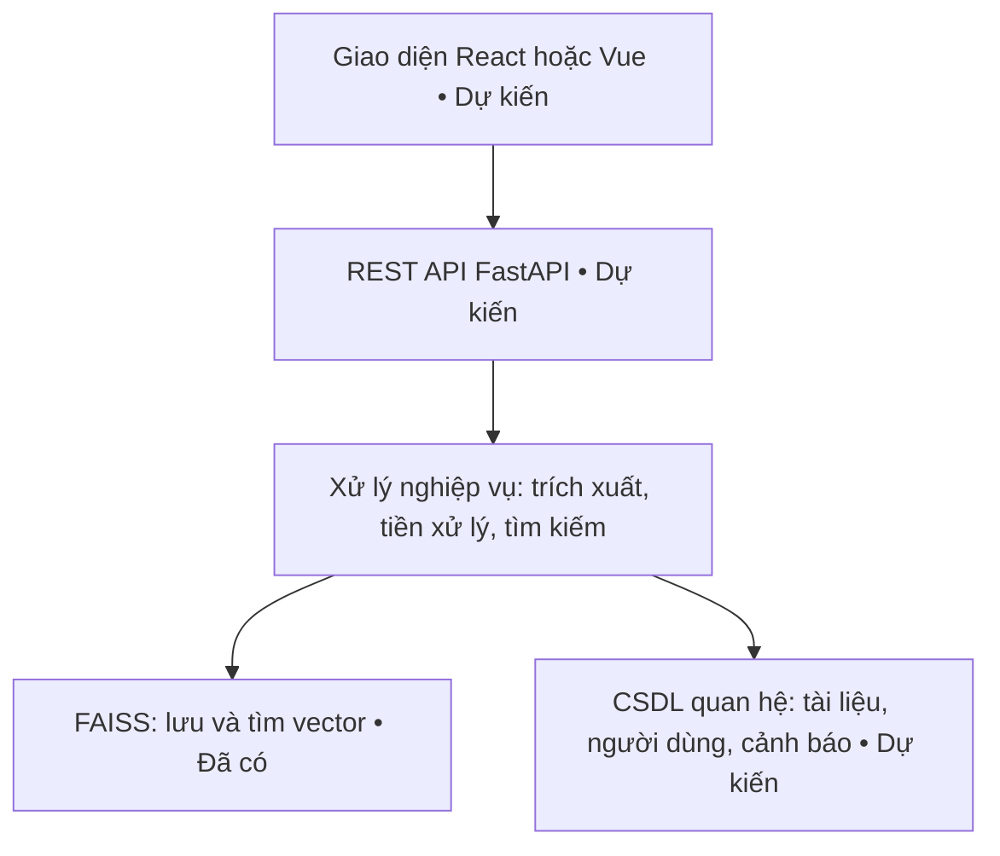
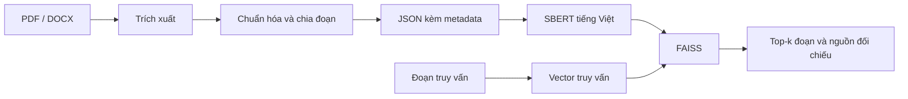

# Nội dung thuyết trình báo cáo tiến độ đợt 1

Thời lượng gợi ý: 12–15 phút, gồm khoảng 3 phút demo. Mỗi mục dưới đây tương ứng một slide. Phần “Lời dẫn” đặt trong ghi chú thuyết trình, không đưa hết lên slide.

## Slide 1. Giới thiệu đề tài

**XÂY DỰNG HỆ THỐNG TỰ ĐỘNG KIỂM TRA VÀ CẢNH BÁO TRÙNG LẶP VĂN BẢN TRONG BÁO CÁO ĐỒ ÁN**

Báo cáo tiến độ đợt 1

Trường Đại học Đà Lạt — Khoa Công nghệ Thông tin

Sinh viên: Trần Văn Ngọc Phong, Nguyễn Hoàng Hà, Lã Triều Nguyên

Giảng viên hướng dẫn: La Quốc Thắng

**Lời dẫn:** Kính thưa thầy và các thầy cô, nhóm em xin trình bày tiến độ đợt 1 của đề tài xây dựng hệ thống tự động kiểm tra và cảnh báo trùng lặp văn bản trong báo cáo đồ án.

## Slide 2. Thành viên thực hiện

| Họ và tên | MSSV | Lớp | Email |
|---|---|---|---|
| Trần Văn Ngọc Phong | 2212441 | CTK46A | 2212441@dlu.edu.vn |
| Nguyễn Hoàng Hà | 2212362 | CTK46A | 2212362@dlu.edu.vn |
| Lã Triều Nguyên | 2212428 | CTK46A | 2212428@dlu.edu.vn |

**Giảng viên hướng dẫn:** La Quốc Thắng

**Lời dẫn:** Nhóm gồm ba thành viên thuộc lớp CTK46A, thực hiện đề tài dưới sự hướng dẫn của thầy La Quốc Thắng.

## Slide 3. Mục tiêu đề tài

- Tự động tiếp nhận, trích xuất và lập chỉ mục nội dung báo cáo PDF/DOCX.
- Tìm các đoạn tương đồng ngữ nghĩa với kho tài liệu tham chiếu, hướng tới nhận diện cả diễn đạt lại.
- Cung cấp cảnh báo kèm nguồn đối chiếu, điểm tương đồng và vị trí đoạn văn.
- Hỗ trợ giảng viên kiểm tra và đưa ra kết luận.

**Lời dẫn:** Đơn vị so sánh của hệ thống là từng đoạn văn. Kết quả cần giúp giảng viên biết đoạn nào cần xem xét và đối chiếu với tài liệu nào. Điểm tương đồng chỉ là thông tin hỗ trợ thẩm định.

## Slide 4. Phạm vi và đầu ra

**Đầu vào:** Báo cáo tiếng Việt dạng PDF có lớp văn bản và DOCX.

**Hiện tại:** Xử lý tài liệu cục bộ, chia đoạn, tạo vector và tìm kiếm qua dòng lệnh.

**Đầu ra hiện tại:** Danh sách đoạn gần nhất, điểm tương đồng, tên tệp và trường vị trí.

**Đích hoàn thiện:** Giao diện tải báo cáo, kiểm tra, xem cảnh báo và đối chiếu nguồn.

**Lời dẫn:** Đợt 1 tập trung vào nền tảng xử lý và tìm kiếm. Giao diện web và cơ chế tự động phân mức cảnh báo thuộc các đợt tiếp theo. PDF scan hiện chỉ có cảnh báo cần OCR.

## Slide 5. Kiến trúc hệ thống dự kiến

Sơ đồ đề xuất để đưa lên slide:



- Phân lớp để tách giao diện, API, xử lý nghiệp vụ và lưu trữ.
- Lõi xử lý đã có trong các module Python.
- Hiện tại metadata lưu trong JSON/pickle, chưa có CSDL quan hệ.

**Lời dẫn:** Đây là kiến trúc đích. Trong phiên bản hiện tại, nhóm gọi trực tiếp các module qua dòng lệnh. Sau này API sẽ gọi lại các hàm xử lý này để phục vụ giao diện.

## Slide 6. Luồng xử lý hiện tại



- `extractor.py`: đọc nội dung PDF/DOCX.
- `preprocessor.py`: làm sạch, tách câu/từ và chia đoạn.
- `pipeline.py`: điều phối xử lý và xuất JSON.
- `vector_store.py`: tạo vector, lưu kho và tìm kiếm.

**Lời dẫn:** Luồng lập kho và luồng truy vấn cùng sử dụng mô hình embedding. Metadata đi kèm từng vector giúp truy ngược về đoạn văn và tài liệu nguồn.

## Slide 7. Công nghệ sử dụng

| Công nghệ | Vai trò | Trạng thái |
|---|---|---|
| Python, pdfplumber, python-docx | Điều phối và trích xuất tài liệu | Đã có trong mã nguồn |
| underthesea | Tách câu và tách từ tiếng Việt | Đã có trong mã nguồn |
| sentence-transformers | Chạy model `keepitreal/vietnamese-sbert` | Đã tích hợp |
| faiss-cpu, IndexFlatIP | Lưu vector và tìm kiếm tương đồng | Đã tích hợp |
| FastAPI, SQLAlchemy | API và dữ liệu nghiệp vụ | Dự kiến |
| React/Vue, OCR | Giao diện và đọc PDF scan | Dự kiến |

**Lời dẫn:** Nhóm ưu tiên hoàn thiện chuỗi xử lý trước. Các công nghệ web và OCR chưa phải chức năng đã triển khai. Lựa chọn frontend cuối cùng cần chốt khi bắt đầu xây giao diện.

## Slide 8. Lý thuyết: tiền xử lý và chia đoạn

- Chuẩn hóa Unicode NFC để thống nhất biểu diễn dấu tiếng Việt.
- Loại dòng số riêng lẻ, dòng phân cách và khoảng trắng dư.
- Tách câu, gộp câu thành chunk với tham số mặc định 500 ký tự.
- Tách từ tiếng Việt để tạo `tokenized_text` phục vụ vector hóa.
- Giữ `chunk_id`, `source_file`, `page` để truy vết.

**Ví dụ minh họa tách từ:** “sinh viên” có thể biểu diễn thành “sinh_viên”.

**Lời dẫn:** Chia đoạn giúp so sánh từng phần nội dung. Mốc 500 ký tự hiện là tham số gộp câu, chưa phải giới hạn cứng vì một câu dài có thể vượt mốc này. Với DOCX, trường page hiện luôn bằng 1 nên chưa biểu thị đúng trang thực tế.

## Slide 9. Lý thuyết: vector ngữ nghĩa và cosine

- SBERT chuyển đoạn văn thành vector số biểu diễn nội dung.
- Hệ thống chuẩn hóa vector L2 trước khi đưa vào FAISS.
- Cosine đo mức tương đồng về hướng giữa hai vector.

**Công thức:** `cos(u, v) = (u · v) / (||u|| × ||v||)`

Khi hai vector có độ dài bằng 1: `cos(u, v) = u · v`.

- `IndexFlatIP` xếp hạng theo tích vô hướng trên vector đã chuẩn hóa.
- Top-k trả về các đoạn gần nhất, kể cả khi chúng chưa đủ tương đồng để cảnh báo.

**Lời dẫn:** Cách biểu diễn này là cơ sở để tìm nội dung gần nghĩa. Điểm cosine có miền lý thuyết từ âm 1 đến 1, không phải phần trăm đạo văn. Nhóm chưa có ngưỡng đã hiệu chỉnh hoặc số đo chứng minh chất lượng phát hiện diễn đạt lại.

## Slide 10. Các công việc đã thực hiện trong đợt 1

| Hạng mục | Sản phẩm hiện có | Người thực hiện |
|---|---|---|
| Trích xuất PDF và DOCX | `extractor.py` | [Điền theo phân công thực tế] |
| Chuẩn hóa, tách câu/từ, chia đoạn | `preprocessor.py` | [Điền theo phân công thực tế] |
| Điều phối xử lý tài liệu, xuất JSON | `pipeline.py` | [Điền theo phân công thực tế] |
| Vector hóa, FAISS, tìm kiếm CLI | `vector_store.py` | [Điền theo phân công thực tế] |
| Tài liệu và kế hoạch triển khai | README, kế hoạch v2 | [Điền theo phân công thực tế] |

**Lời dẫn:** Kết quả đợt 1 là các module nền tảng và dữ liệu đầu ra để tiếp tục phát triển chức năng kiểm tra. Nhóm trình bày người phụ trách đúng theo công việc thực tế.

## Slide 11. Kết quả hiện có và giới hạn

**Minh chứng trong thư mục dự án**

- Có bốn module Python cho chuỗi xử lý và tìm kiếm.
- Có 2 tệp JSON với 17 chunk: PDF 13 chunk, DOCX 4 chunk.
- Có tệp `vector_store.index` và `vector_store.meta.pkl` đã lưu.
- CLI hỗ trợ xây kho, nạp kho và tìm kiếm top-5.

**Chưa có kết quả đánh giá Precision, Recall, F1 hoặc benchmark trên kho lớn.**

**Lời dẫn:** Số liệu 17 chunk là số đếm từ JSON hiện có. Kế hoạch ghi 17 vector từ 3 tài liệu, nhưng thư mục dữ liệu hiện có 2 tài liệu nên cần đồng bộ lại trước khi công bố số liệu về kho index. Phần trình bày này không khẳng định đã chạy lại mô hình trong buổi soạn slide.

## Slide 12. Thuận lợi và khó khăn hiện tại

| Thuận lợi từ nền tảng hiện có | Khó khăn cần giải quyết |
|---|---|
| Các module tách riêng, thuận tiện bổ sung chức năng | Dữ liệu mẫu còn ít, chưa có tập gán nhãn |
| Đã kết nối tiền xử lý với vector hóa và FAISS | Chưa chọn được ngưỡng cảnh báo có cơ sở đánh giá |
| JSON giữ nguồn và nội dung từng đoạn | DOCX chưa xác định đúng vị trí trang |
| Kho vector có cơ chế lưu và nạp lại | PDF scan cần OCR, chưa có kiểm thử tự động |

**Lời dẫn:** Thuận lợi chính nằm ở chuỗi xử lý đã được tổ chức thành từng phần. Khó khăn ưu tiên là dữ liệu đánh giá và khả năng truy vết, vì hai yếu tố này ảnh hưởng trực tiếp đến mức tin cậy của cảnh báo. Nhóm có thể bổ sung khó khăn về lịch làm việc hoặc thiết bị nếu thực tế có phát sinh.

## Slide 13. Công việc dự kiến ở đợt tiếp theo

| Thời gian theo kế hoạch | Công việc | Sản phẩm dự kiến |
|---|---|---|
| 14/09–20/09 | Chuẩn bị 10–15 tài liệu thử nghiệm, đo sơ bộ | Bộ dữ liệu và log demo |
| 21/09–27/09 | Cải thiện vị trí DOCX, kiểm thử lõi, chuẩn bị tập nhãn và ngưỡng | Test tối thiểu và cấu hình ngưỡng |
| 28/09–04/10 | Xây CSDL và API xử lý/tìm kiếm | Lưu metadata và endpoint hoạt động |
| 05/10–11/10 | Xây giao diện tối thiểu và tích hợp | Luồng tải tài liệu, xem kết quả |
| 12/10–18/10 | Bổ sung so khớp từ vựng và kết hợp hai hướng | Demo cho báo cáo tiến độ 2 |

**Lời dẫn:** Đây là kế hoạch dự kiến, chưa phải kết quả hoàn thành. Nhóm ưu tiên sửa khả năng truy vết và bổ sung kiểm thử, sau đó mới tích hợp API, CSDL và giao diện. Winnowing hoặc MinHash là hướng bổ sung để hỗ trợ nhận diện sao chép trực tiếp.

## Slide 14. Kế hoạch kiểm chứng kết quả

- Chuẩn bị cặp đoạn sao chép, diễn đạt lại, cùng chủ đề nhưng khác nội dung và không liên quan.
- Gán nhãn thủ công, tách dữ liệu hiệu chỉnh ngưỡng với dữ liệu đánh giá.
- Đo Precision, Recall và F1 cho quyết định cảnh báo.
- Đo thời gian trích xuất, vector hóa và tìm kiếm.
- Kiểm tra nguồn đối chiếu, tài liệu rỗng, PDF scan và loại trừ chính tài liệu đang kiểm tra.

**Lời dẫn:** Nhóm cần kiểm tra cả cảnh báo sai và bỏ sót. Khi đánh giá, tài liệu truy vấn phải tách khỏi kho tham chiếu hoặc có cơ chế loại trừ cùng tài liệu. Kết quả tự khớp không chứng minh khả năng phát hiện diễn đạt lại.

## Slide 15. Demo phiên bản hiện tại

**1. Trích xuất:** Mở một PDF có lớp văn bản hoặc DOCX và xem JSON đầu ra.

**2. Kiểm tra chunk:** Chỉ ra nội dung, mã đoạn và tên tài liệu nguồn.

**3. Tìm kiếm:** Chạy truy vấn trên kho đã lưu.

**4. Đối chiếu:** Mở tài liệu nguồn của kết quả để giải thích điểm tương đồng.

**Phạm vi demo:** Dòng lệnh, chưa có giao diện web và phân mức cảnh báo tự động.

**Lời dẫn:** Sau đây nhóm minh họa luồng trích xuất và tìm kiếm. Với mỗi kết quả, nhóm chỉ ra nguồn đối chiếu và giải thích vì sao cần giảng viên xem xét nội dung trước khi kết luận.

## Slide 16. Định hướng hoàn thiện và trao đổi

- Đợt 1 đã có nền tảng trích xuất, tiền xử lý và tìm kiếm ngữ nghĩa.
- Đợt tiếp theo tập trung ngưỡng cảnh báo, CSDL, API và giao diện.
- Nhóm mong nhận góp ý về bộ dữ liệu đánh giá và cách trình bày cảnh báo.

**Nhóm em xin cảm ơn thầy cô đã lắng nghe.**

**Lời dẫn:** Nhóm mong thầy cô góp ý về tiêu chí đánh giá và thông tin cần thể hiện trong báo cáo đối chiếu để hệ thống hỗ trợ tốt hơn cho việc thẩm định đồ án.

---

# Ghi chú chuẩn bị demo (không đưa lên slide)

## Các lệnh theo mã nguồn hiện tại

Chạy tại thư mục gốc dự án, trong môi trường đã cài `requirements.txt`.

```powershell
# Trích xuất một tài liệu hiện có, chỉ in kết quả
python extractor.py "Data/file_dxl/01. HDUQ.pdf"

# Tìm kiếm trên kho đã lưu, dùng câu truy vấn đã chuẩn bị
python vector_store.py search "câu truy vấn đã chuẩn bị"
```

Để demo luồng batch, tạo thư mục riêng `demo_input`, đặt bản sao tài liệu thử vào đó và chạy:

```powershell
python pipeline.py demo_input demo_output/chunks.json
```

Lệnh batch này xuất JSON riêng. Nó không tự lập lại kho FAISS. Lệnh `python vector_store.py build` đọc `request/pdf` và `request/word`, rồi ghi lại kho mặc định, vì vậy chỉ chạy khi đã chuẩn bị đúng bộ dữ liệu nguồn.

Chế độ `python pipeline.py --watch` quét thư mục đầu vào **một lần** và chuyển các tệp đã xử lý sang `Data/file_dxl`. Đây chưa phải dịch vụ theo dõi liên tục.

## Chuẩn bị tình huống demo

1. Chọn một đoạn từ tài liệu trong kho để minh họa truy xuất nguồn.
2. Chuẩn bị một câu diễn đạt lại và một câu không liên quan. Chạy thử trước, ghi nhận kết quả thực tế, không đặt trước điểm số kỳ vọng.
3. Khi so sánh các truy vấn, dùng cùng cách tiền xử lý. CLI `search` truyền nguyên chuỗi vào model, chưa tự gọi hàm tách từ như luồng lập kho. Có thể chuẩn bị chuỗi truy vấn đã tách từ trước buổi báo cáo.
4. Cache mô hình trước buổi demo. Chuẩn bị ảnh chụp hoặc log từ một lần chạy thật để dự phòng.
5. Không gọi top-5 là “5 đoạn đạo văn”. Đây là 5 đoạn được xếp hạng gần nhất.
6. Không demo dữ liệu cá nhân không cần thiết. Ưu tiên tài liệu mẫu do nhóm tạo cho buổi trình bày.

## Thông tin cần bổ sung trước khi trình bày

- Người thực hiện từng hạng mục ở slide 10: dự án chưa có bằng chứng phân công theo tên.
- Đồng bộ số tài liệu và số vector giữa kế hoạch, JSON và index khi chốt bản demo.
- Bổ sung thời gian xử lý hoặc chất lượng tìm kiếm chỉ sau khi đã đo thực tế.

## Nguồn nội bộ dùng để soạn

- `IMPLEMENTATION_PLAN_v2.md`: mục tiêu kiến trúc, hiện trạng và lịch triển khai.
- `extractor.py`, `preprocessor.py`, `pipeline.py`, `vector_store.py`: đối chiếu chức năng thực tế.
- `requirements.txt`: các thư viện hiện khai báo.
- `request/pdf/01. HDUQ.json`: 13 chunk.
- `request/word/2212362_NHHa_DeCuongTTNN.json`: 4 chunk.

README chưa cập nhật phần vector store. Khi mô tả trạng thái hiện tại, nội dung này ưu tiên mã nguồn thay cho mục “bước tiếp theo” trong README.
